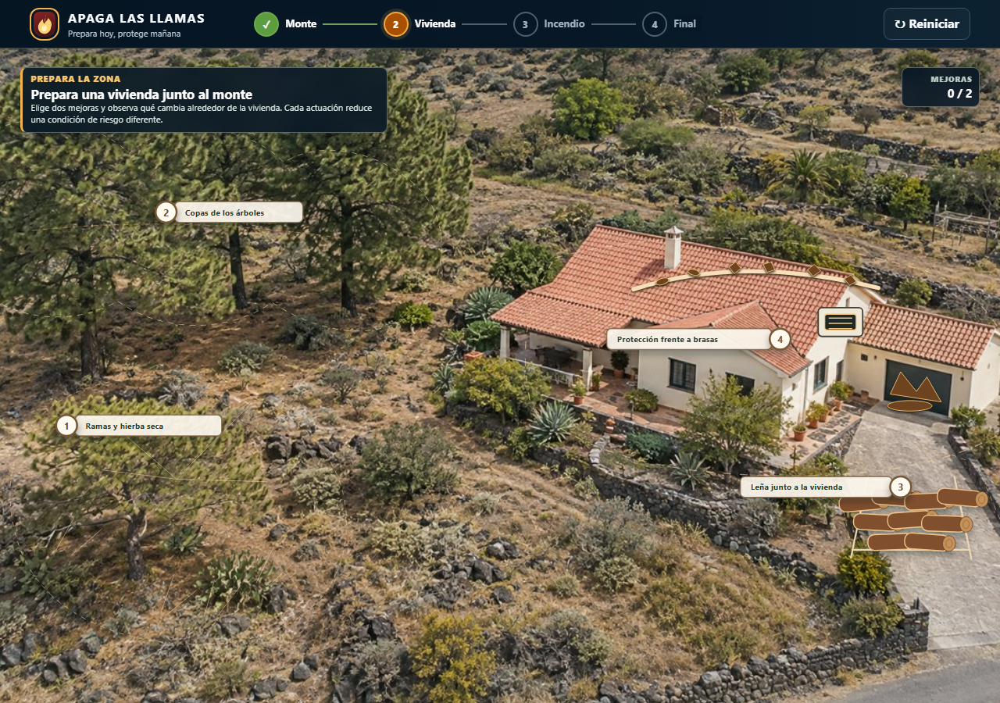
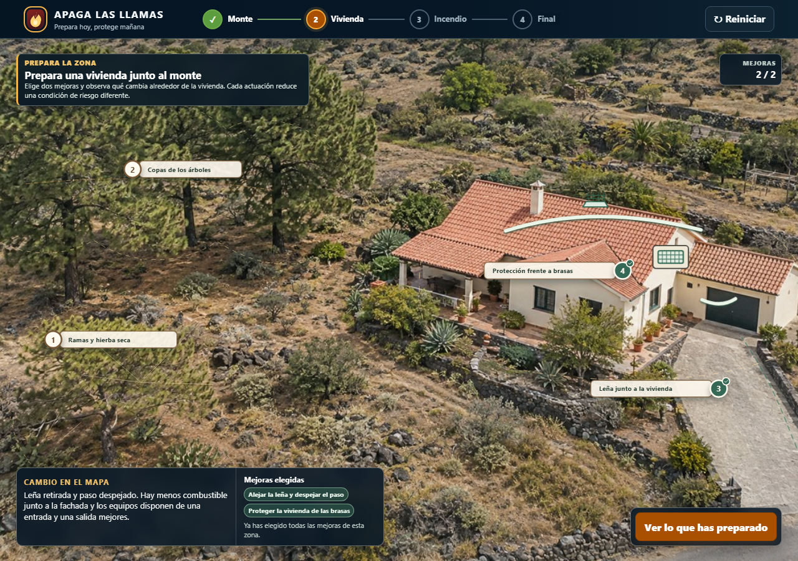
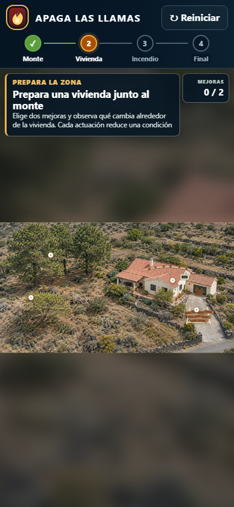
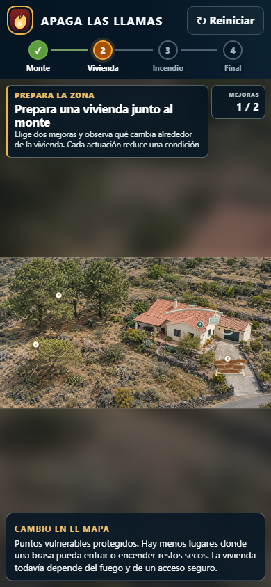

# Evidencia visual — defensa pasiva de la vivienda

Capturas reales del recorrido ejecutado el 22 de octubre de 2026 con `scripts/m4-browser-smoke.mjs` contra la aplicación compilada.

## Escritorio — 1280 × 900

| Estado inicial | Estado tratado |
|---|---|
|  |  |

## Móvil — 390 × 844

| Estado inicial | Estado tratado |
|---|---|
|  |  |

## Recorrido validado

- acceso a los cuatro puntos desde el mapa;
- apertura de tarjeta con ratón, teclado y control táctil;
- selección de dos actuaciones entre cuatro y bloqueo de una tercera;
- animación única de limpieza de canalón e instalación de protecciones;
- estado final estable y alternativa inmediata con `prefers-reduced-motion`;
- retirada visible de la leña y recuperación del paso;
- ramas `prepared` y `vulnerable`, incluida la prioridad del acceso crítico;
- relación causal específica en el informe final;
- sin overflow horizontal ni errores de consola.

El estado tratado reduce vulnerabilidades, pero no presenta la vivienda como completamente segura.
